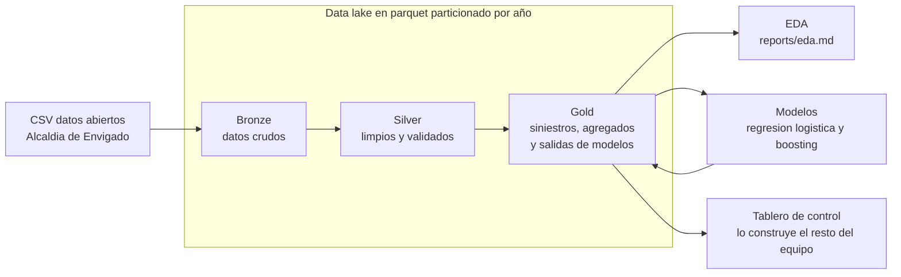

# Accidentalidad vial en Envigado

Proyecto integrador de ciencia de datos sobre los siniestros de transito del
municipio de Envigado entre 2010 y 2022, con datos abiertos publicados por la
Alcaldia de Envigado en datos.gov.co.

Este repositorio cubre la parte de datos y modelado: ingesta, limpieza,
analisis exploratorio y modelos, organizados con una arquitectura Medallion.
El tablero de control se construye aparte y consume la capa gold.

## Integrantes

- Daniel Felipe Arango Guarin
- Miguel Angel Cano Salinas
- Santiago Acevedo Urrego
- Santiago Betancur

## Arquitectura



- Bronze guarda el CSV tal como llega, solo particionado por año.
- Silver corrige los dos formatos de fecha y hora, quita 38,022 duplicados
  exactos, extrae coordenadas y deja tipos y nombres limpios.
- Gold deja una fila por siniestro con la gravedad mas alta reportada, los
  agregados que necesita el tablero y las metricas y predicciones de los
  modelos.

Todas las capas se guardan en formato parquet. Bronze, silver y la tabla de
siniestros van particionadas por año en carpetas `año=2010` a `año=2022`,
el mismo esquema de particiones que usa S3 con Athena o Glue.

## Como correr el proyecto en local

```bash
pip install -r requirements.txt
```

```bash
python -m src.pipeline
```

Ese comando corre las cuatro etapas en orden. Tambien se pueden correr una
por una:

```bash
python -m src.bronze
```

```bash
python -m src.silver
```

```bash
python -m src.gold
```

```bash
python -m src.modelos
```

El analisis exploratorio genera las figuras del informe:

```bash
python -m src.eda
```

Las conclusiones del EDA estan en [reports/eda.md](reports/eda.md).

## Que consume el tablero

Todo lo que necesita el tablero queda en `data/gold`:

| Ruta | Contenido |
|---|---|
| `gold/siniestros/` | Una fila por siniestro, particionado por año |
| `gold/agregados/por_mes.parquet` | Serie mensual de siniestros y victimas |
| `gold/agregados/por_barrio.parquet` | Siniestros, victimas y muertos por barrio |
| `gold/agregados/por_dia_hora.parquet` | Matriz dia de la semana por hora |
| `gold/agregados/por_clase.parquet` | Conteos por clase de accidente |
| `gold/agregados/por_causa.parquet` | Conteos por causa |
| `gold/agregados/por_gravedad_año.parquet` | Gravedad por año |
| `gold/modelos/metricas.json` | Metricas de los dos modelos y la particion usada |
| `gold/modelos/predicciones.parquet` | Probabilidad de victimas por siniestro de prueba |
| `gold/modelos/*.joblib` | Modelos entrenados |

## Modelos

El objetivo es predecir si un siniestro deja victimas, es decir heridos o
muertos, a partir del contexto del reporte: hora, dia, mes, franja, barrio,
area, clase de accidente y causa.

La evaluacion usa una particion temporal: se entrena con 2010 a 2019 y se
evalua con 2020 a 2022. Asi la prueba imita el uso real, predecir el futuro
con el pasado, y evita que el modelo se beneficie de informacion de los
mismos años que debe predecir.

| Modelo | ROC AUC | Average precision | Brier |
|---|---|---|---|
| Regresion logistica | 0.747 | 0.637 | 0.172 |
| Gradient boosting | 0.741 | 0.635 | 0.172 |

La prevalencia de victimas en la prueba es 0.304, asi que un average
precision de 0.637 duplica con holgura la linea base. La regresion logistica
queda como modelo principal por su desempeño y su simplicidad.

## Migracion a AWS

El acceso a almacenamiento esta aislado en [src/config.py](src/config.py).
Las rutas se arman a partir de la variable de entorno `DATA_DIR`, que en
local apunta a la carpeta `data` del repositorio. Para correr contra S3:

```bash
pip install s3fs
```

```bash
DATA_DIR=s3://mi-bucket/accidentes-envigado python -m src.pipeline
```

No hay que cambiar codigo: pandas y pyarrow leen y escriben parquet en S3
con las mismas llamadas, y las particiones por año quedan como prefijos del
bucket. En un despliegue real el mapa seria:

| Local | AWS |
|---|---|
| Carpeta `data` | Bucket de S3 |
| `python -m src.pipeline` | Job de AWS Glue o tarea programada |
| Lectura de gold con pandas | Athena sobre el catalogo de Glue |
| Figuras y metricas | Tablero que lee la capa gold |

Los unicos archivos que se escriben con la libreria estandar en vez de
pandas son `metricas.json` y los `.joblib`; en S3 se subirian con boto3 o
se dejarian en el almacenamiento del job.

## Fuente de los datos

Accidentalidad Municipio de Envigado, datos abiertos de la Alcaldia de
Envigado en datos.gov.co. Corte de noviembre de 2022. El CSV original esta
en `data/raw/accidentalidad_envigado.csv`.
