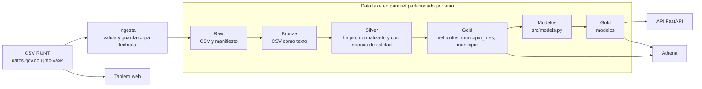
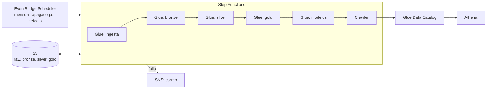

# Prediccion de la gravedad de los siniestros viales en Colombia a partir del vehiculo involucrado

Proyecto integrador de la maestria en ciencia de datos. Usa el registro del
RUNT de vehiculos involucrados en siniestros de transito con heridos o
muertos (Ley 2251 de 2022), publicado por el Ministerio de Transporte en
datos.gov.co: 450,335 vehiculos de 689 municipios entre enero de 2022 y
septiembre de 2026.

El historial de git contiene una version anterior del proyecto sobre la
accidentalidad de Envigado.

## Integrantes

- Daniel Felipe Arango Guarin
- Daniel Correa Botero
- Miguel Angel Cano Salinas
- Santiago Acevedo Urrego
- Santiago Betancur

## Problema

Los siniestros viales son una de las principales causas de muerte evitable
en Colombia: en 2024 murieron 8,271 personas en las vias, segun cifras
preliminares del Observatorio Nacional de Seguridad Vial. La Ley 2251 de 2022
pide gestionar la seguridad vial con un enfoque de sistema seguro, en el que
el vehiculo es uno de los componentes que se pueden intervenir, y su
articulo 11 obliga al RUNT a publicar los vehiculos involucrados en
siniestros con victimas.

La pregunta es predictiva: **estimar la probabilidad de que un siniestro con
victimas sea con muertos** a partir del vehiculo (tipo, marca, modelo, edad)
y del contexto del registro (mes, departamento, autoridad de transito), con
un modelo que tambien funcione en municipios que no vio al entrenar. Ademas
se agrupan los municipios por su perfil para ver si el modelo rinde igual en
todos y se compara la letalidad observada de cada municipio con la esperada.

El evento es poco frecuente: 23,899 registros con muertos, el 5.3 %. Por eso
los modelos se miden con PR-AUC, sensibilidad, precision y calibracion, no
con exactitud.

## Fuente de los datos y sus limites

Ministerio de Transporte - RUNT. Vehiculos involucrados en un accidente de
transito Ley 2251-2022, datos.gov.co, conjunto
[6jmc-vaxk](https://www.datos.gov.co/d/6jmc-vaxk), licencia CC BY-SA 4.0:
hay que citar al Ministerio de Transporte y al RUNT y compartir los datos
derivados con la misma licencia. 9 columnas, sin datos personales. El CSV
(unos 50 MB) no se versiona en git: lo deja `python -m src.ingesta` en
`data/raw/vehiculos_siniestros_runt.csv`, y `data/raw/manifiesto.json`
registra su huella sha256 y las validaciones.

Lo que hay que tener en cuenta al leer los resultados:

- **Cada fila es un vehiculo, no un siniestro.** El pipeline le da a cada
  fila un `id_registro` (RUNT-000001 a RUNT-450335, por su posicion en el
  CSV), asi que las 159,399 filas que en la fuente son identicas a otra se
  distinguen y se conservan: dos vehiculos iguales en el mismo mes y
  municipio son reales. El identificador es del registro del vehiculo, no
  del siniestro: la fuente no trae dia, hora, direccion, causa ni datos de
  las victimas, asi que no se sabe que vehiculos estuvieron en el mismo
  siniestro.
- **La gravedad es del siniestro, no del vehiculo.** Si chocan un camion y
  una moto y muere el motociclista, los dos quedan "con muertos". El modelo
  encuentra asociaciones, no dice que vehiculo causo la muerte.
- **La cobertura cambia en el tiempo.** Medellin pasa de 27,821 registros
  en 2024 (con su carga masiva repartida) a 201 en 2025 y Bogota de 19,184 a
  4,526. Por eso la proporcion nacional con muertos sube de 5.1 % en 2024 a
  7.4 % en 2025.
- **Hay cargas masivas**: reportes atrasados que se subieron con una sola
  fecha, como los 22,667 registros de Medellin en julio de 2024 (8.8 veces
  su mediana mensual). La capa silver reparte el exceso entre los meses
  anteriores del municipio (21,230 filas, marcadas con `fecha_imputada`) y
  marca los municipios y meses con reporte anomalo. Las filas reubicadas y
  las de meses anomalos (23,752, el 5.3 %) se excluyen del entrenamiento, y
  2025-2026 se evalua aparte.
- **La autoridad de transito pesa mucho** en el modelo: la Direccion de
  Transito y Transporte de la Policia cubre vias nacionales, donde los
  siniestros son mas graves. Parte de esa senal puede ser forma de reportar
  y no riesgo.
- Solo hay siniestros con victimas, y no hay coordenadas ni poblacion para
  calcular tasas por habitante.

## Arquitectura



- La ingesta (`python -m src.ingesta`) descarga el CSV del portal y valida
  las 9 columnas, el formato MM/AAAA de la fecha, que la gravedad solo tenga
  sus dos valores y que filas y vacios sean razonables. Guarda la copia
  vigente en `raw/vehiculos_siniestros_runt.csv`, una copia fechada en
  `raw/historico/fecha_ingesta=AAAA-MM-DD/` y la bitacora en
  `raw/manifiesto.json`. Si la validacion falla, el archivo va a
  `raw/rechazados/` y la copia vigente no cambia. Con `--archivo ruta.csv`
  ingesta una copia local en vez de descargarla.
- Bronze guarda el CSV tal como llega, como texto, particionado por `anio`,
  y le agrega `id_registro`, un identificador unico por fila tomado de su
  posicion en el CSV.
- Silver normaliza textos y marcas, agrupa las marcas y tipos poco
  frecuentes (`OTRAS`, `OTRO`), crea la clave de municipio con el
  departamento, el año y el mes, y reparte las cargas masivas: un municipio
  y mes con mas de 3 veces su mediana mensual de 2022-2024 se queda con la
  mediana (filas al azar, semilla 42) y el exceso pasa a los meses
  anteriores del municipio en proporcion a lo que reporto cada uno, nunca a
  un año anterior al del modelo del vehiculo menos uno. Las filas movidas
  guardan el mes publicado en `periodo_original` y llevan
  `fecha_imputada = 1`. Despues recalcula la edad al momento del siniestro
  (`anio - modelo`, con piso en 0), marca valores imposibles y marca los
  municipios y meses con reporte anomalo.
- Gold deja las tres tablas de la base del proyecto; la etapa de modelos
  agrega sus salidas en `gold/modelos`.

Gold es la capa que lee Athena, asi que los nombres van sin tildes ni ñ y
cada tabla tiene su propia carpeta. El detalle del analisis exploratorio
esta en [reports/eda.md](reports/eda.md).

## Como correr el proyecto en local

```bash
pip install -r requirements.txt
```

1. **Ingesta**, la primera vez o cuando el RUNT publique una version nueva:

   ```bash
   python -m src.ingesta
   ```

2. **Pipeline** completo (bronze, silver, gold y modelos, unos 7 minutos),
   que vuelve a validar la copia cruda y se detiene si falla:

   ```bash
   python -m src.pipeline
   ```

   Tambien se pueden correr las etapas una por una: `python -m src.bronze`,
   `python -m src.silver`, `python -m src.gold` y `python -m src.models`.
   `python -m src.eda` genera las figuras de `reports/figuras/`. Con
   `DATA_DIR=s3://bucket` el mismo codigo lee y escribe en S3.

3. **Tablero web**: exportar los datos y abrir la pagina.

   ```bash
   python scripts/exportar_tablero_runt.py
   python -m http.server 8000 --directory dashboard
   ```

4. **API de prediccion**:

   ```bash
   pip install -r requirements-api.txt
   python -m uvicorn api.main:app --host 127.0.0.1 --port 8020
   ```

5. **Pruebas** de la API, con una copia del modelo entrenado:

   ```bash
   pip install -r api/requirements-test.txt
   mkdir -p build/api_fixture/gold
   cp -r data/gold/modelos build/api_fixture/gold/modelos
   python -m pytest tests -v
   ```

## Tablas de gold

| Ruta | Contenido |
|---|---|
| `gold/vehiculos/anio=AAAA/` | Una fila por vehiculo, identificada por `id_registro` (primera columna; identifica el registro, no el siniestro): periodo, mes, departamento, municipio, autoridad, tipo y marca (originales y agrupados), clase de vehiculo, modelo, edad, marcas de calidad (`modelo_invalido`, `cobertura_anomala`, `fecha_imputada`), mes publicado (`periodo_original`) y objetivo `con_muertos` (0/1) |
| `gold/municipio_mes/` | Municipio por mes (todos los meses, tambien los que no tienen registros): registros despues del reparto y como se publicaron (`registros_publicados`), registros que salieron y llegaron por el reparto (`registros_reubicados_desde`, `registros_reubicados_hacia`), con muertos, `prop_con_muertos`, mediana de referencia 2022-2024 y alertas de caida y carga masiva |
| `gold/municipio/` | Una fila por municipio: registros, `prop_con_muertos`, edad promedio, proporcion de motos, de carga y de registros de la autoridad nacional, y `apto_agrupamiento` (100 o mas registros) |
| `gold/modelos/metricas.json` | Descripcion completa del entrenamiento: particion, variables, umbral, busqueda de hiperparametros, validacion agrupada, prueba temporal, calibracion, importancia de variables, agrupamiento y casos de ejemplo |
| `gold/modelos/<modelo>.joblib` | El mejor modelo calibrado, el que sirve la API |
| `gold/modelos/metricas/` | Una fila por modelo y evaluacion (la prueba temporal es `evaluacion = 'temporal_2024'`) |
| `gold/modelos/predicciones/` | Probabilidad y alerta de cada vehiculo: fuera de pliegue en 2022-2024 y modelo final en 2025-2026 |
| `gold/modelos/grupos/` | Grupo de cada municipio con 100 o mas registros y sus variables |
| `gold/modelos/letalidad/` | Letalidad observada contra esperada por municipio |

Las proporciones (`prop_*`) van de 0 a 1.

## Modelos

`python -m src.models` entrena sobre `gold/vehiculos` un clasificador de
`con_muertos` con tipo, marca agrupada, modelo, edad, mes, departamento y
autoridad de transito. El municipio no es variable: el modelo se piensa para
municipios que no vio.

- **Seleccion**: validacion cruzada agrupada por municipio (GroupKFold k=5)
  sobre 2022-2024, sin los meses con cobertura anomala ni las filas con
  fecha reubicada (327,068 filas), con busqueda de hiperparametros en
  rejilla.
- **Prueba temporal**: entrena con 2022-2023 y prueba con 2024. Los modelos
  se calibran con regresion isotonica.
- **Umbral**: perder un siniestro con muertos se supone 10 veces mas costoso
  que una falsa alarma, lo que da un umbral de 1 / 11 = 0.0909 sobre
  probabilidades calibradas.
- **Agrupamiento**: k-means contra jerarquico (Ward) sobre los 210
  municipios con 100 o mas registros, k elegido por silueta.

Resultados de `data/gold/modelos/metricas.json` (version
`runt-2026-11-20-deb82db1`):

| Modelo | PR-AUC validacion agrupada | PR-AUC prueba 2024 | ROC-AUC 2024 | Sensibilidad 2024 | Precision 2024 |
|---|---|---|---|---|---|
| Prevalencia (referencia) | 0.052 | 0.052 | 0.500 | 0.000 | 0.000 |
| Regresion logistica | 0.143 | 0.221 | 0.825 | 0.612 | 0.199 |
| **Gradient boosting** | **0.162** | **0.232** | **0.825** | **0.606** | **0.206** |
| Bosque aleatorio | 0.156 | 0.215 | 0.817 | 0.572 | 0.203 |

- Gana gradient boosting (mayor PR-AUC media en la validacion agrupada). En
  2024 su PR-AUC es 4.5 veces la prevalencia (0.052); en el umbral 0.0909
  alerta el 15 % de los registros y encuentra el 61 % de los que tuvieron
  muertos.
- La variable que mas pesa es la autoridad de transito, seguida del
  departamento y el tipo de vehiculo (importancia por permutacion).
- En 2025-2026, con la cobertura cambiada, la PR-AUC es 0.271 sobre una
  prevalencia de 0.078.
- El agrupamiento elige k-means con 2 grupos (silueta 0.31): municipios
  grandes con reporte municipal y municipios pequeños dominados por la
  autoridad nacional, con letalidad tres veces mayor.

Se usaron solo pandas, numpy, pyarrow, scikit-learn y joblib para que corra
en Glue: la busqueda de hiperparametros es en rejilla en vez de optuna, y la
importancia por permutacion reemplaza a SHAP. Detalle y decisiones en
[reports/modelo.md](reports/modelo.md).

## Tablero web

[dashboard/](dashboard/) es un tablero web estatico (HTML, CSS y JavaScript
sin dependencias) dirigido a secretarias de movilidad y autoridades de
transito. Sigue el orden de la exposicion: el problema, la calidad del dato
(la caida del reporte de Medellin y Bogota en 2025, la carga masiva de julio
de 2024 y el estado del reporte de cada municipio mes a mes), como se
trataron esas inconsistencias, los hallazgos por vehiculo y contexto (con
filtros por periodo, departamento y tipo de vehiculo), el modelo y las
acciones que se proponen. Lee `dashboard/data/datos.js`, que genera:

```bash
python scripts/exportar_tablero_runt.py
```

El script lee la capa gold despues de `python -m src.pipeline`: la tabla
`vehiculos` (con la edad recalculada y la bandera `cobertura_anomala`), la
tabla `municipio_mes` (estado del reporte) y `modelos`. Los hallazgos
excluyen los registros de meses con reporte anomalo, igual que el
entrenamiento. Luego basta con abrir `dashboard/index.html` en el navegador
o servir la carpeta con `python -m http.server`.

## API de prediccion

[api/](api/) publica el mejor modelo con FastAPI. Recibe un vehiculo con
campos naturales (tipo, marca, año modelo, fecha `MM/AAAA`, departamento y
autoridad), deriva mes, edad y los grupos de tipo y marca igual que la capa
silver, y devuelve la probabilidad de que el siniestro tenga muertos, la
alerta segun el umbral de decision y la version del modelo. Tiene lote de
hasta 100 vehiculos, llave de acceso opcional (`API_KEY`), registro de
versiones (`python -m api.register_model` y `MODEL_VERSION`) y lee el modelo
con `src.config`, asi que sirve desde `data/` o desde S3. Detalle, ejemplos
reales, versionado y seguridad en [docs/api.md](docs/api.md).

## Despliegue en AWS

Toda la infraestructura esta en codigo en [infra/](infra/), con Serverless
Framework. Un solo comando la crea, otro corre el pipeline y otro la borra
por completo. **Estado: el codigo de despliegue esta actualizado para el
RUNT pero no se ha vuelto a desplegar.**



| Recurso | Que hace |
|---|---|
| Bucket S3 | El lago: `raw/`, `bronze/`, `silver/`, `gold/` y `scripts/` |
| Job de ingesta | Job de Python shell que corre `src/ingesta.py`: descarga y valida el CSV; si el portal no responde usa la copia de `raw/respaldo/` |
| 4 jobs de Glue | bronze, silver, gold y modelos. Todos corren [glue_jobs/run_stage.py](glue_jobs/run_stage.py), que llama al modulo de pandas de `src` que le toca |
| Step Functions | Corre las etapas en orden, reintenta una vez cada una y avisa por SNS si algo falla |
| Crawler y base de datos de Glue | Registran `silver/vehiculos`, las tres tablas de gold y `gold/modelos/{metricas,predicciones,grupos,letalidad}` para consultarlas con Athena |
| Workgroup de Athena | Consultas con un limite de 1 GB escaneado por consulta |
| EventBridge Scheduler | Corre el pipeline el dia 1 de cada mes. Se crea apagado |
| Usuario IAM de solo lectura | Solo puede consultar gold con Athena; su llave la crea `infra/scripts/powerbi.sh` |

Los jobs usan el mismo codigo de `src` que en local: [src/config.py](src/config.py)
lee y escribe en S3 con pyarrow cuando `DATA_DIR` es `s3://...`, y limpia cada
carpeta antes de escribir, asi que correr el pipeline varias veces no duplica
datos. Las etapas corren con pandas en el driver de Glue (450 mil filas caben
en memoria). **Pendiente: el procesamiento distribuido con Spark** que pide
la base del proyecto; la version anterior en Spark implementaba el esquema
viejo y se retiro.

### Requisitos

- AWS CLI v2 (`winget install Amazon.AWSCLI` en Windows) o el dev container de
  los laboratorios, que ya la trae.
- Serverless Framework v4 (`npm install -g serverless`).
- Python 3.9 o mas reciente, para empaquetar `src`.
- Credenciales: copiar `infra/.env.example` a `infra/.env` y llenarlo. El
  usuario de AWS necesita permisos para crear roles de IAM.
- El CSV en `data/raw/vehiculos_siniestros_runt.csv` (`python -m src.ingesta`):
  `deploy.sh` lo sube como copia de respaldo.

Los comandos se corren desde la raiz del repositorio, en Git Bash o en el dev
container. El stack se llama `accidentes-runt`.

### Montar, probar y desmontar

```bash
bash infra/scripts/deploy.sh     # crea todo y sube codigo y CSV de respaldo
bash infra/scripts/run.sh        # corre el pipeline y espera al crawler
bash infra/scripts/destroy.sh    # borra todo, pide confirmacion
bash infra/scripts/status.sh     # muestra que existe en AWS en este momento
bash infra/scripts/api.sh deploy # la API en Lambda, ver docs/api.md
```

`run.sh` termina con error si alguna etapa falla, asi que sirve como prueba de
humo: si termina bien, imprime el contenido de `gold/` y las metricas de los
modelos. `destroy.sh` detiene ejecuciones en curso, vacia el bucket y borra
el stack; no se pierde nada, porque el codigo esta en el repositorio y el
CSV se vuelve a descargar. Hay que correr `api.sh remove` antes de
`destroy.sh`.

Para encender la ejecucion mensual:

```bash
bash infra/scripts/deploy.sh --param="scheduleState=ENABLED"
```

Para recibir un correo cuando el pipeline falle, poner `ALERT_EMAIL` en
`infra/.env` antes de desplegar y aceptar el correo de confirmacion de AWS.

### Costos

Con el stack montado y sin correr, el costo es practicamente cero: Glue, Step
Functions, el crawler y Athena solo cobran cuando se ejecutan, y el bucket
guarda unos cientos de MB. Cada corrida usa cuatro jobs de Glue de 2 DPU y un
job de Python shell; el entrenamiento es la etapa mas larga. El scheduler se
crea apagado para que un despliegue nunca dispare corridas por su cuenta.

### Consultas en Athena

En la consola de Athena, elegir el workgroup `accidentes-runt` y la base de
datos `accidentes_runt`. Cuando termina `run.sh` ya estan las tablas de la
seccion de gold:

```sql
SELECT anio, sum(registros) AS registros, sum(con_muertos) AS con_muertos,
       round(1.0 * sum(con_muertos) / sum(registros), 4) AS prop_con_muertos
FROM municipio_mes
GROUP BY anio
ORDER BY anio;
```

```sql
SELECT modelo, average_precision AS pr_auc, roc_auc, recall, "precision"
FROM metricas
WHERE evaluacion = 'temporal_2024'
ORDER BY pr_auc DESC;
```

`silver/vehiculos` y `gold/vehiculos` se llaman igual; el crawler le agrega
un sufijo a la segunda tabla que registre.
