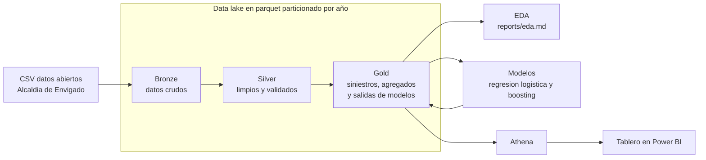
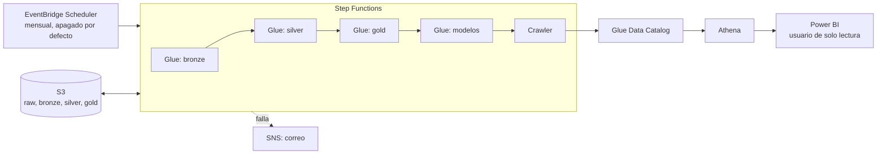
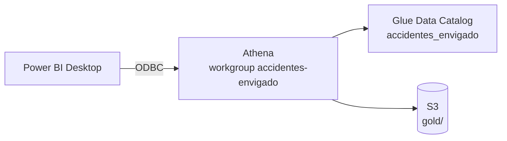

# Accidentalidad vial en Envigado

Proyecto integrador de ciencia de datos sobre los siniestros de transito del
municipio de Envigado entre 2010 y 2022, con datos abiertos publicados por la
Alcaldia de Envigado en datos.gov.co.

Este repositorio cubre la parte de datos y modelado: ingesta, limpieza,
analisis exploratorio y modelos, organizados con una arquitectura Medallion.
El tablero de control se construye en Power BI y lee la capa gold desde S3
a traves de Athena.

## Integrantes

- Daniel Felipe Arango Guarin
- Miguel Angel Cano Salinas
- Santiago Acevedo Urrego
- Santiago Betancur

## Arquitectura



- Bronze guarda el CSV tal como llega, solo particionado por año.
- Silver corrige los dos formatos de fecha y hora, quita 38,022 duplicados
  exactos, extrae coordenadas y deja tipos y nombres limpios.
- Gold deja una fila por siniestro con la gravedad mas alta reportada, los
  agregados que necesita el tablero y las metricas y predicciones de los
  modelos.

Todas las capas se guardan en formato parquet. Bronze y silver van
particionadas por año en carpetas `año=2010` a `año=2022`, el mismo esquema
de particiones que usa S3 con Athena o Glue.

Gold es la capa que lee Power BI, asi que sigue dos reglas para que Athena la
registre sin problemas: los nombres van sin tildes ni ñ (la columna de año se
llama `anio` y la tabla de siniestros va en carpetas `anio=2010` a
`anio=2022`), y cada tabla tiene su propia carpeta.

## Como correr el proyecto en local

```bash
pip install -r requirements.txt
```

```bash
python -m src.pipeline
```

Ese comando corre las cuatro etapas en orden. Tambien se pueden correr una
por una:

```bash
python -m src.bronze
```

```bash
python -m src.silver
```

```bash
python -m src.gold
```

```bash
python -m src.models
```

El analisis exploratorio genera las figuras del informe:

```bash
python -m src.eda
```

Las conclusiones del EDA estan en [reports/eda.md](reports/eda.md).

## Que consume el tablero

Todo lo que necesita el tablero queda en `data/gold`. Cada carpeta es una
tabla de Athena con el mismo nombre, que es la que se ve en Power BI:

| Ruta | Tabla en Athena | Contenido |
|---|---|---|
| `gold/siniestros/` | `siniestros` | Una fila por siniestro, particionado por `anio` |
| `gold/agregados/por_mes/` | `por_mes` | Serie mensual de siniestros y victimas |
| `gold/agregados/por_barrio/` | `por_barrio` | Siniestros, victimas y muertos por barrio |
| `gold/agregados/por_dia_hora/` | `por_dia_hora` | Matriz dia de la semana por hora |
| `gold/agregados/por_clase/` | `por_clase` | Conteos por clase de accidente |
| `gold/agregados/por_causa/` | `por_causa` | Conteos por causa |
| `gold/agregados/por_gravedad_anio/` | `por_gravedad_anio` | Gravedad por año |
| `gold/modelos/predicciones/` | `predicciones` | Probabilidad de victimas por siniestro de prueba |
| `gold/modelos/metricas/` | `metricas` | Una fila por modelo con sus metricas y su matriz de confusion |
| `gold/modelos/metricas.json` | | Las mismas metricas y la particion usada, en JSON |
| `gold/modelos/*.joblib` | | Modelos entrenados |

## Modelos

El objetivo es predecir si un siniestro deja victimas, es decir heridos o
muertos, a partir del contexto del reporte: hora, dia, mes, franja, barrio,
area, clase de accidente y causa.

La evaluacion usa una particion temporal: se entrena con 2010 a 2019 y se
evalua con 2020 a 2022. Asi la prueba imita el uso real, predecir el futuro
con el pasado, y evita que el modelo se beneficie de informacion de los
mismos años que debe predecir.

| Modelo | ROC AUC | Average precision | Brier |
|---|---|---|---|
| Regresion logistica | 0.747 | 0.637 | 0.172 |
| Gradient boosting | 0.741 | 0.635 | 0.172 |

La prevalencia de victimas en la prueba es 0.304, asi que un average
precision de 0.637 duplica con holgura la linea base. La regresion logistica
queda como modelo principal por su desempeño y su simplicidad.

## Expansion sintetica a 5 millones de filas

Para probar que la arquitectura aguanta un volumen grande, el proyecto
incluye una expansion sintetica de la capa silver:

```bash
python -m src.expand
```

Cada fila real se replica 97 veces desplazando su fecha k meses, con k entre
-48 y 48, y se recalculan año, mes y dia de la semana. El resultado son
5,024,988 filas en parquet particionado por año, de 2006 a 2026, unos 109 MB
en `data/expandido/accidentes`. La columna `desplazamiento_meses` rastrea el
origen de cada fila: el valor 0 es el dato real.

Estos datos son sinteticos y sirven solo para las pruebas de volumen y
particiones. El EDA y la evaluacion de los modelos usan los datos reales.
La carpeta no se versiona en git: se regenera con el comando de arriba.

## Despliegue en AWS

Toda la infraestructura esta en codigo en [infra/](infra/), con Serverless
Framework, igual que los laboratorios de Big Data. Un solo comando la crea,
otro corre el pipeline y otro la borra por completo.



| Recurso | Que hace |
|---|---|
| Bucket S3 | El lago: `raw/`, `bronze/`, `silver/`, `gold/` y `scripts/` |
| 4 jobs de Glue | Uno por etapa. Todos corren [glue_jobs/run_stage.py](glue_jobs/run_stage.py), que llama al modulo de `src` que le toca |
| Step Functions | Corre las etapas en orden, reintenta una vez cada una y avisa por SNS si algo falla |
| Crawler y base de datos de Glue | Registran `silver/accidentes` y todas las tablas de gold para consultarlas con Athena |
| Workgroup de Athena | Consultas con un limite de 1 GB escaneado por consulta |
| EventBridge Scheduler | Corre el pipeline el dia 1 de cada mes. Se crea apagado |
| Usuario IAM `accidentes-envigado-powerbi` | Solo puede consultar gold con Athena. Es el que usa Power BI |

Los jobs usan el mismo codigo de `src` que en local: [src/config.py](src/config.py)
lee y escribe en S3 con pyarrow cuando `DATA_DIR` es `s3://...`, y limpia cada
carpeta antes de escribir, asi que correr el pipeline varias veces no duplica
datos.

### Requisitos

- AWS CLI v2 (`winget install Amazon.AWSCLI` en Windows) o el dev container de
  los laboratorios, que ya la trae.
- Serverless Framework v4 (`npm install -g serverless`).
- Python 3.9 o mas reciente, solo para empaquetar `src`.
- Credenciales: copiar `infra/.env.example` a `infra/.env` y llenarlo. Sirven
  los mismos valores de `.envs/aws.env` y `.envs/sls.env` de los laboratorios.
  El usuario de AWS necesita permisos para crear roles de IAM.

Los comandos se corren desde la raiz del repositorio, en Git Bash o en el dev
container.

### Montar, probar y desmontar

```bash
bash infra/scripts/deploy.sh     # crea todo y sube codigo y CSV (1 a 3 min)
bash infra/scripts/run.sh        # corre el pipeline y espera al crawler (12 a 17 min)
bash infra/scripts/powerbi.sh    # crea la llave de Power BI e imprime los datos del ODBC
bash infra/scripts/destroy.sh    # borra todo, pide confirmacion
bash infra/scripts/status.sh     # muestra que existe en AWS en este momento
```

`run.sh` termina con error si alguna etapa falla, asi que sirve como prueba de
humo: si termina bien, imprime el contenido de `gold/` y las metricas de los
modelos.

`destroy.sh` detiene ejecuciones en curso, vacia el bucket y borra el stack. Al
final verifica que no quede ni el stack ni el bucket. No se pierde nada: el
codigo y el CSV crudo estan en el repositorio, asi que `deploy.sh` y `run.sh`
reconstruyen el lago completo. Para volver a montarlo despues de una semana
basta con correr esos dos scripts otra vez.

### Opciones

```bash
# Encender la ejecucion mensual
bash infra/scripts/deploy.sh --param="scheduleState=ENABLED"
```

Para recibir un correo cuando el pipeline falle, poner `ALERT_EMAIL` en
`infra/.env` antes de desplegar y aceptar el correo de confirmacion que manda
AWS.

### Costos

Con el stack montado y sin correr, el costo es practicamente cero: Glue, Step
Functions, el crawler y Athena solo cobran cuando se ejecutan, y el bucket
guarda unos 20 MB. Cada corrida completa usa cuatro jobs de Glue de 2 DPU por 2
a 4 minutos cada uno, del orden de 0.20 USD. El scheduler se crea apagado para
que un despliegue nunca dispare corridas por su cuenta.

### Consultas en Athena

En la consola de Athena, elegir el workgroup `accidentes-envigado` y la base de
datos `accidentes_envigado`. Cuando termina `run.sh` ya estan la tabla
`accidentes` (silver) y las de gold de la tabla de arriba:

```sql
SELECT anio, count(*) AS siniestros, sum(con_victimas) AS con_victimas
FROM siniestros
GROUP BY anio
ORDER BY anio;
```

En silver la particion se llama `año`; si se consulta, va entre comillas
dobles: `"año"`.

## Power BI

Power BI no tiene conector directo a S3. La forma sencilla es su conector
**Amazon Athena**: Power BI le hace consultas SQL a Athena, y Athena lee los
parquet de gold en S3. No hay que copiar ni exportar datos.



### Tablero

El tablero esta en [powerbi/Accidentes.pbip](powerbi/Accidentes.pbip), un
proyecto de Power BI en formato de texto que se versiona en git. Tiene cuatro
paginas: Resumen, Cuando, Donde y por que, y Modelo.

Para abrirlo:

1. Abrir `powerbi/Accidentes.pbip` con Power BI Desktop.
2. En **Transformar datos > Editar parametros**, revisar `RutaGold`: debe ser
   la carpeta `data\gold` de este repositorio en ese computador.
3. Pulsar **Actualizar**. El proyecto no guarda datos, asi que la primera vez
   siempre hay que actualizar.

El parametro `FuenteDatos` elige de donde leer: `Local` usa los parquet de
`data/gold` y sirve sin AWS; `Athena` consulta las tablas de gold por el DSN
de `DsnAthena`, configurado con los pasos de abajo. Las tablas son las mismas
en los dos casos.

El proyecto se genera con `python scripts/generar_pbip.py`. Volver a correrlo
borra los cambios hechos en Power BI Desktop, asi que una vez el equipo
empiece a editar el tablero en Desktop, los cambios se hacen alla.

### Pasos para conectar con Athena, una sola vez por computador

1. Con el stack montado y el pipeline corrido, ejecutar
   `bash infra/scripts/powerbi.sh`. Imprime la region, la base, el workgroup,
   la carpeta de resultados y una llave de acceso de solo lectura. El secreto
   se muestra una sola vez; si se pierde, se vuelve a correr el script y crea
   otra.
2. Instalar el driver ODBC de Amazon Athena (version 2.x, Windows de 64 bits)
   desde la documentacion de Athena: *Connecting to Amazon Athena with ODBC*.
3. Abrir **Origenes de datos ODBC (64 bits)** en Windows, pestaña **DSN de
   sistema**, **Agregar**, elegir el driver de Amazon Athena y llenar los
   campos con lo que imprimio el script: Data Source Name
   `accidentes-envigado`, Region `us-east-1`, Catalog `AwsDataCatalog`,
   Database `accidentes_envigado`, Workgroup `accidentes-envigado`, S3 Output
   Location, y en **Authentication Options** el tipo *IAM Credentials* con la
   llave y el secreto. Probar con **Test**.
4. En Power BI Desktop: **Obtener datos**, buscar **Amazon Athena**, escribir
   el DSN `accidentes-envigado`, modo **Importar**, y en la siguiente ventana
   elegir **Usar credenciales del origen de datos** (las del DSN).
5. En el navegador abrir `AwsDataCatalog` > `accidentes_envigado` y marcar las
   tablas que necesite el tablero.

### Recomendaciones

- Usar modo **Importar**, no DirectQuery. Gold son unos 44 mil siniestros,
  cabe de sobra en Power BI, los visuales responden al instante y Athena solo
  cobra cuando se actualiza (centavos). Con DirectQuery cada clic en un
  visual es una consulta paga.
- `siniestros` alcanza para casi todo el tablero; los agregados sirven para
  visuales rapidos y para comprobar que los totales cuadren. Las relaciones
  utiles son `siniestros[radicado]` con `predicciones[radicado]` (1 a 1, solo
  2020 a 2022) y una tabla calendario sobre `siniestros[fecha]`.
- `con_victimas` vale 0 o 1, asi que su suma es el numero de siniestros con
  victimas y su promedio la proporcion.
- Para actualizar: correr `run.sh` y luego **Actualizar** en Power BI.
  Publicado en Power BI Service, la actualizacion programada necesita un
  gateway; para el proyecto basta con actualizar desde Desktop y volver a
  publicar.
- Si se corre `destroy.sh`, el DSN deja de funcionar. Tras `deploy.sh` y
  `run.sh`, correr `powerbi.sh` y poner la llave nueva en el DSN. El informe
  de Power BI no cambia, porque las tablas se llaman igual.

## Fuente de los datos

Accidentalidad Municipio de Envigado, datos abiertos de la Alcaldia de
Envigado en datos.gov.co. Corte de noviembre de 2022. El CSV original esta
en `data/raw/accidentalidad_envigado.csv`.
