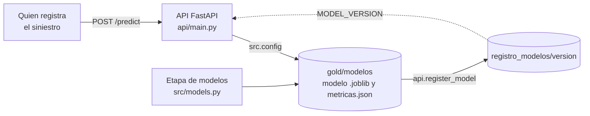
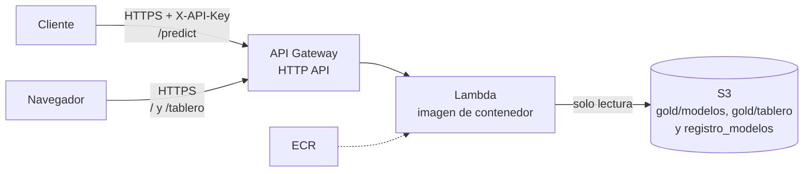

# API de prediccion

La API publica el modelo entrenado por el pipeline sobre el RUNT (vehiculos
involucrados en siniestros con victimas, Ley 2251 de 2022). Recibe un
vehiculo de un siniestro con victimas y devuelve la probabilidad de que ese
siniestro tenga muertos.

## Para que sirve y quien la llama

La llama quien registra o revisa siniestros con victimas (por ejemplo un
organismo de transito o el equipo de seguridad vial de un departamento). Con
la respuesta puede **priorizar la revision y el seguimiento de los siniestros
con mayor probabilidad de ser mortales**.

La API no decide sola. Entrega:

- `probabilidad`: numero entre 0 y 1, calibrado (regresion isotonica).
- `alerta`: verdadero si la probabilidad alcanza el `umbral_decision` del
  entrenamiento (0.0909: perder un siniestro con muertos se supuso 10 veces
  mas costoso que una falsa alarma).
- `entrada_modelo`: las variables con las que se consulto el modelo, ya
  derivadas, para revisar cada respuesta.
- `version`: que modelo respondio.

## Como esta hecha



| Archivo | Que hace |
|---|---|
| [api/main.py](../api/main.py) | La aplicacion FastAPI: rutas, llave de acceso y manejo de errores |
| [api/schemas.py](../api/schemas.py) | Los campos de entrada y salida, con sus limites |
| [api/model_store.py](../api/model_store.py) | Lee el modelo con `src.config` y arma la fila que el modelo espera |
| [api/register_model.py](../api/register_model.py) | Guarda una copia versionada del modelo |
| [api/lambda_handler.py](../api/lambda_handler.py) | Entrada para AWS Lambda: la misma aplicacion, sin reescribirla |
| [api/Dockerfile](../api/Dockerfile) | Imagen para correrla con Docker |
| [api/Dockerfile.lambda](../api/Dockerfile.lambda) | Imagen para AWS Lambda |
| [infra/api/serverless.yml](../infra/api/serverless.yml) | Lambda y API Gateway en codigo |
| [infra/scripts/api.sh](../infra/scripts/api.sh) | Desplegar, probar y borrar la API en AWS |
| [tests/test_api_prediccion.py](../tests/test_api_prediccion.py) | Pruebas funcionales |

Decisiones principales:

- **El modelo se lee con `src.config`**, igual que el resto del proyecto. Con
  `DATA_DIR=data` lee la carpeta local; con `DATA_DIR=s3://bucket` lee S3.
- **La API lee el contrato de `gold/modelos/metricas.json`**: `mejor_modelo`
  (que archivo cargar), `variables`, `umbral_decision` y `version`. Si el
  modelo pide una variable que la API no sabe construir, o `metricas.json` no
  describe las variables, la API no lo sirve y responde 503.
- **Quien llama envia datos naturales**: tipo, marca, año modelo, fecha
  (`MM/AAAA`, como en el RUNT, o `anio` y `mes`), departamento y autoridad. La
  API deriva lo demas igual que la capa silver ([src/silver.py](../src/silver.py)),
  usando sus funciones y constantes:
  - los textos se limpian con `normalize_text` (mayusculas, sin tildes, sin
    espacios repetidos): `Secretaría distrital` es `SECRETARIA DISTRITAL`;
  - `edad = anio - modelo`, con piso en 0 (un modelo se vende el año antes);
  - un año modelo posterior a `anio + 1` o anterior a 1950 se rechaza (en
    silver es `modelo_invalido`); si no se envia, `modelo` y `edad` van
    vacios y el modelo los trata como desconocidos;
  - un tipo o una marca que el modelo no vio (raros o nuevos) van a `OTRO`
    y `OTRAS`, los mismos grupos de silver, y se avisa en
    `categorias_agrupadas`.
- **Una categoria desconocida no tumba la API.** Un departamento o una
  autoridad que el modelo no vio se responde igual y se avisa en
  `categorias_desconocidas`.

## Rutas

| Ruta | Que hace |
|---|---|
| `GET /health` | Estado, modelo cargado, version, variables, umbral y de donde se cargo |
| `POST /predict` | Probabilidad de muertos para un vehiculo |
| `POST /predict/batch` | Lo mismo para una lista de hasta 100 vehiculos |
| `GET /docs` | Documentacion interactiva (OpenAPI), generada por FastAPI |
| `GET /tablero` | Datos del tablero web: el JSON que deja el pipeline en `gold/tablero/datos.json`. Publico, sin llave |
| `GET /` | El tablero web (archivos de `dashboard/`) |

`/tablero` se sirve tal como esta guardado, comprimido con gzip si el
navegador lo acepta, y se guarda en memoria `TABLERO_TTL_SECONDS` segundos
(300 por defecto): una corrida nueva del pipeline aparece a los pocos
minutos. Si S3 falla despues de la primera lectura, sigue sirviendo la copia
en memoria. Sin datos responde 503.

Campos de un vehiculo:

| Campo | Obligatorio | Detalle |
|---|---|---|
| `tipo` | Si | Tipo de vehiculo, por ejemplo `MOTOCICLETA`, `AUTOMOVIL`, `TRACTOCAMION` |
| `marca` | No | Marca. Vacia o rara va a `OTRAS` |
| `modelo` | No | Año modelo, entre 1950 y el año del siniestro + 1 |
| `fecha` | Si, o `anio` y `mes` | Mes del siniestro en formato `MM/AAAA` |
| `anio`, `mes` | Si no hay `fecha` | Año (2000 a 2100) y mes (1 a 12) del siniestro |
| `departamento` | Si | Departamento del siniestro |
| `autoridad` | Si | Autoridad de transito que reporta |
| `identificador` | No | Se devuelve tal cual |

## Como correrla en local

```bash
pip install -r requirements-api.txt
```

Despues de correr el pipeline (`python -m src.pipeline`), que deja el modelo
en `data/gold/modelos`:

```bash
python -m uvicorn api.main:app --host 127.0.0.1 --port 8020
```

El tablero queda en http://127.0.0.1:8020/ y la documentacion interactiva en
http://127.0.0.1:8020/docs. Solo responden en este computador.

Variables de entorno:

| Variable | Para que |
|---|---|
| `DATA_DIR` | Donde esta el lago. Por defecto `data`. En AWS, `s3://<bucket>` |
| `API_KEY` | Si se define, `/predict` y `/predict/batch` exigen el encabezado `X-API-Key` |
| `MODEL_VERSION` | Si se define, sirve esa version del registro en vez del ultimo modelo |
| `TABLERO_TTL_SECONDS` | Cada cuanto se vuelven a leer los datos del tablero. Por defecto 300 |
| `DASHBOARD_DIR` | Carpeta del tablero web. Por defecto `dashboard/` del repositorio |

### Ejemplo real

Peticiones hechas con curl el 2026-11-21 contra la API desplegada en AWS
(`https://xl60pqw9ll.execute-api.us-east-1.amazonaws.com`), con el modelo `runt-2026-11-21-68160f32` leido de S3. En local
es igual cambiando la URL por `http://127.0.0.1:8020`; sin `API_KEY` no hace
falta el encabezado `X-API-Key`.

Estado:

```bash
curl -s $URL/health
```

```json
{"estado":"ok","modelo":"gradient_boosting","version":"runt-2026-11-21-68160f32","sha256":"cdcec432673f756713c2c90f560b4c5be38bf57caa37d29990870cdee3f490ff","objetivo":"con_muertos","umbral_decision":0.0909,"variables":{"categoricas":["tipo_grupo","marca_grupo","departamento","autoridad"],"numericas":["modelo","edad","mes"]},"origen":"s3://accidentes-runt-lake-298363283541/gold/modelos/gradient_boosting.joblib","requiere_api_key":true}
```

Una moto nueva en una via nacional (la reporta la Direccion de Transito y
Transporte de la Policia): alerta.

```bash
curl -s -X POST $URL/predict \
  -H "Content-Type: application/json" -H "X-API-Key: $API_KEY" \
  -d '{"tipo":"MOTOCICLETA","marca":"AKT","modelo":2023,"fecha":"06/2024","departamento":"ANTIOQUIA","autoridad":"DIRECCION DE TRANSITO Y TRANSPORTE","identificador":"V-1"}'
```

```json
{"identificador":"V-1","probabilidad":0.1847,"alerta":true,"entrada_modelo":{"tipo_grupo":"MOTOCICLETA","marca_grupo":"AKT","departamento":"ANTIOQUIA","autoridad":"DIRECCION DE TRANSITO Y TRANSPORTE","modelo":2023.0,"edad":1.0,"mes":6.0},"categorias_agrupadas":[],"categorias_desconocidas":[],"umbral_decision":0.0909,"modelo":"gradient_boosting","version":"runt-2026-11-21-68160f32"}
```

Un tipo y una marca que el modelo no conoce, sin año modelo, con textos en
minusculas y una autoridad inventada: responde y lo avisa.

```bash
curl -s -X POST $URL/predict \
  -H "Content-Type: application/json" -H "X-API-Key: $API_KEY" \
  -d '{"tipo":"Patineta electrica","fecha":"03/2024","departamento":"bogota d.c.","autoridad":"Transito inventado"}'
```

```json
{"identificador":null,"probabilidad":0.0502,"alerta":false,"entrada_modelo":{"tipo_grupo":"OTRO","marca_grupo":"OTRAS","departamento":"BOGOTA D.C.","autoridad":"TRANSITO INVENTADO","modelo":null,"edad":null,"mes":3.0},"categorias_agrupadas":["tipo_grupo","marca_grupo"],"categorias_desconocidas":["autoridad"],"umbral_decision":0.0909,"modelo":"gradient_boosting","version":"runt-2026-11-21-68160f32"}
```

Una peticion sin autoridad: 422 con el campo y el motivo.

```
HTTP/1.1 422 Unprocessable Entity

{"detail":[{"campo":"autoridad","mensaje":"Field required"}]}
```

Varios vehiculos a la vez (con `fecha` o con `anio` y `mes`):

```bash
curl -s -X POST $URL/predict/batch \
  -H "Content-Type: application/json" -H "X-API-Key: $API_KEY" \
  -d '{"vehiculos":[{"identificador":"V-1","tipo":"AUTOMOVIL","marca":"CHEVROLET","modelo":2015,"anio":2024,"mes":3,"departamento":"BOGOTA D.C.","autoridad":"SECRETARIA DISTRITAL DE MOVILIDAD DE BOGOTA"},{"identificador":"V-2","tipo":"TRACTOCAMION","marca":"KENWORTH","modelo":2012,"fecha":"12/2024","departamento":"CESAR","autoridad":"DIRECCION DE TRANSITO Y TRANSPORTE"}]}'
```

```json
{"modelo":"gradient_boosting","version":"runt-2026-11-21-68160f32","umbral_decision":0.0909,"total":2,"predicciones":[{"identificador":"V-1","probabilidad":0.019,"alerta":false,"entrada_modelo":{"tipo_grupo":"AUTOMOVIL","marca_grupo":"CHEVROLET","departamento":"BOGOTA D.C.","autoridad":"SECRETARIA DISTRITAL DE MOVILIDAD DE BOGOTA","modelo":2015.0,"edad":9.0,"mes":3.0},"categorias_agrupadas":[],"categorias_desconocidas":[]},{"identificador":"V-2","probabilidad":0.4236,"alerta":true,"entrada_modelo":{"tipo_grupo":"TRACTOCAMION","marca_grupo":"KENWORTH","departamento":"CESAR","autoridad":"DIRECCION DE TRANSITO Y TRANSPORTE","modelo":2012.0,"edad":12.0,"mes":12.0},"categorias_agrupadas":[],"categorias_desconocidas":[]}]}
```

Estas probabilidades son las de los `casos` de `metricas.json`, que las
pruebas comparan con la API. Los numeros cambian si se vuelve a entrenar; la
`version` de la respuesta dice con cual se calcularon.

## Como correrla en Docker

Desde la raiz del repositorio:

```bash
docker build -f api/Dockerfile -t accidentes-api .
```

```bash
docker run --rm -p 127.0.0.1:8021:8080 -v "$PWD/data:/data:ro" -e API_KEY=una-clave accidentes-api
```

La imagen solo lleva el codigo de `api/` y `src/` y el tablero de
`dashboard/` sin la copia `datos.js` (ver `.dockerignore`). El
modelo no va dentro de la imagen: se monta la carpeta de datos en solo
lectura, o se pasa `-e DATA_DIR=s3://<bucket>` con credenciales de AWS. El
servicio corre con un usuario sin privilegios.

Esta imagen (`api/Dockerfile`, con uvicorn) no se ha vuelto a construir con
el modelo del RUNT. La de AWS es otra, `api/Dockerfile.lambda`, y esa si se
construyo y esta desplegada.

## Pruebas

```bash
pip install -r api/requirements-test.txt
mkdir -p build/api_fixture/gold
cp -r data/gold/modelos build/api_fixture/gold/modelos
python -m pytest tests -v
```

`tests/test_tablero_web.py` prueba `/tablero` (contenido, gzip, cache, 503
sin datos y copia en memoria si el almacenamiento falla), la pagina en `/`,
que las rutas de la API no queden tapadas por la pagina y el tablero a
traves del manejador de Lambda. No necesita el modelo.

Las pruebas usan el `TestClient` de FastAPI y copian el modelo real de
`build/api_fixture` a una carpeta temporal, asi que no leen ni escriben
`data/`. Si esa copia no existe, se saltan. Cubren: estado; que la API
reproduzca con campos naturales las probabilidades de los `casos` de
`metricas.json`; igualdad con el modelo llamado directamente; `fecha` contra
`anio` y `mes`; edad con piso en 0; limpieza de textos como silver;
agrupacion en `OTRO` y `OTRAS`; categorias desconocidas; decision segun el
umbral; entradas invalidas con 422; lote; llave de acceso; versionado;
lectura por URI (el mismo camino de S3); modelos que la API no puede servir
(503) y el manejador de Lambda con un evento de API Gateway.

## Como se versiona el modelo

1. **Cada modelo tiene una version.** Es el campo `version` de
   `metricas.json`; si el entrenamiento no lo escribe, la API usa la huella
   SHA-256 del archivo (`sha256-<12 caracteres>`). El entrenamiento actual
   escribe versiones como `runt-2026-11-21-68160f32`. `/health` y cada prediccion
   la devuelven, asi que siempre se sabe que modelo respondio.
2. **Cada version se puede guardar sin que se pierda.** La etapa de modelos
   borra y reescribe `gold/modelos` en cada corrida. Este comando copia el
   modelo actual a una carpeta que nadie borra:

   ```bash
   python -m api.register_model
   ```

   ```
   Registered gradient_boosting as version runt-2026-11-20-deb82db1 in data/registro_modelos/runt-2026-11-20-deb82db1
   Serve it with MODEL_VERSION=runt-2026-11-20-deb82db1
   ```

   Deja `modelo.joblib`, `metricas.json` y `manifiesto.json` (version,
   huella, fecha, variables y versiones de Python y scikit-learn) en
   `registro_modelos/<version>/`. Con `DATA_DIR=s3://<bucket>` hace lo mismo
   en S3. Una version no se puede sobrescribir con otro archivo.
3. **Se puede volver a una version anterior.** Con `MODEL_VERSION=<version>`
   la API sirve esa copia en vez del ultimo modelo entrenado.

No se usa MLflow porque seria un servidor mas que montar y pagar para un
solo modelo; una carpeta por version en S3 cumple lo mismo y se explica en
una frase.

## Seguridad

- Todas las entradas tienen limites: textos de 120 caracteres como maximo y
  sin caracteres de control, año del siniestro entre 2000 y 2100, año modelo
  desde 1950 y no posterior al año del siniestro + 1, lotes de 100
  vehiculos, cuerpo de 256 KB. Un campo que no existe se
  rechaza.
- La API solo carga el archivo del modelo que el propio proyecto escribio en
  su almacenamiento. La ruta se arma en el codigo, nunca con datos de la
  peticion, y los nombres del modelo y de la version se validan antes de
  usarlos.
- Los errores no muestran trazas ni rutas internas: la respuesta dice
  `Error interno` o `Modelo no disponible` y el detalle queda en el log.
- `/tablero` y la pagina son publicos a proposito: son agregados de datos
  abiertos (datos.gov.co). Las predicciones siguen protegidas con la llave.
- **Antes de exponerla hay que activar la autenticacion.** Con la variable
  `API_KEY` definida, las predicciones exigen el encabezado `X-API-Key`. En
  local sin esa variable la API queda abierta, por eso solo debe escuchar en
  `127.0.0.1`. El despliegue en AWS no deja desplegar sin llave.
- Para un uso real conviene ademas: guardar la llave en Secrets Manager o
  SSM en vez de una variable de entorno, usar el autorizador IAM de API
  Gateway (`authorizer: aws_iam`) si los clientes son otros servicios de AWS,
  y limitar la concurrencia de la funcion para acotar el costo si alguien
  abusa del servicio.

## Despliegue en AWS

**Estado: desplegada el 2026-11-21** en el stack `accidentes-runt-api`
(us-east-1), con el modelo `runt-2026-11-21-68160f32`. URL actual:
`https://xl60pqw9ll.execute-api.us-east-1.amazonaws.com` (el tablero en `/`, la documentacion en `/docs`). La URL cambia si
se borra y se vuelve a crear el stack; `api.sh test` la imprime.



Se eligio **Lambda con imagen de contenedor detras de un HTTP API de API
Gateway**:

- Un zip de Lambda con capas admite 250 MB descomprimidos. scikit-learn,
  scipy, pandas y pyarrow juntos pasan de ese limite. Una imagen de
  contenedor admite hasta 10 GB; la de la API pesa unos 360 MB comprimida.
- No hay servidor prendido. Lambda cobra por peticion, y este servicio
  recibe pocas. Un endpoint de SageMaker o un contenedor en ECS cobran por
  hora aunque nadie llame.
- Es la misma aplicacion FastAPI. [Mangum](https://mangum.fastapiexpert.com/)
  traduce el evento de API Gateway; no se reescribe nada para la nube.
- Se despliega con Serverless Framework, igual que el lago, pero en un stack
  aparte (`accidentes-runt-api`), para montarla y borrarla sin tocar el
  lago.
- La funcion solo tiene permiso de lectura sobre `gold/modelos/`,
  `gold/tablero/` y `registro_modelos/` del bucket.
- El tablero web va en la misma funcion: una sola URL publica para la
  pagina, sus datos y las predicciones, sin CORS ni otro servicio que
  mantener. No hace falta una maquina virtual: una instancia EC2 cobraria
  por hora aunque nadie entre.

Costo estimado: con el uso del proyecto (cientos de llamadas) queda dentro de
la capa gratuita de Lambda (1 millon de peticiones y 400 mil GB-segundo al
mes). Sin capa gratuita, 10 mil predicciones al mes costarian menos de 0.05
USD entre Lambda y API Gateway, mas unos 0.04 USD al mes por guardar la
imagen en ECR. La primera llamada despues de un rato sin uso tarda unos
segundos mas, porque Lambda arranca el contenedor y lee el modelo de S3.

### Pasos

Requisitos: los mismos del lago (AWS CLI, Serverless Framework v4,
`infra/.env`) y Docker corriendo. El lago debe estar montado y el pipeline
corrido, porque la API lee el modelo de S3.

```bash
bash infra/scripts/deploy.sh         # el lago, si no esta montado
bash infra/scripts/run.sh            # el pipeline: deja el modelo en S3
bash infra/scripts/api.sh deploy     # construye la imagen, despliega y prueba
```

`api.sh deploy` termina con una prueba de humo contra la URL publica:
`/health`, una prediccion sin llave (debe dar 401), una con llave, una
entrada invalida (422), un lote, la pagina del tablero y `/tablero`. Al
final imprime la URL del tablero. Si algo no responde como se espera, el
script falla. La evidencia queda en `build/api_aws_smoke.txt`.

```bash
bash infra/scripts/api.sh test                # repetir la prueba de humo
bash infra/scripts/api.sh register            # guardar la version actual en S3
bash infra/scripts/api.sh deploy <version>    # servir una version registrada
bash infra/scripts/api.sh remove              # borrar la API y su imagen
```

Hay que correr `api.sh remove` antes de `destroy.sh`.

Despues de volver a entrenar (`run.sh`), las instancias nuevas de Lambda
cargan el modelo nuevo; `api.sh deploy` fuerza el cambio de inmediato.

### Que esta probado y que no

| Parte | Estado |
|---|---|
| API en local con uvicorn | Probado con curl con el modelo del RUNT |
| Pruebas automaticas | 60 pruebas en pytest (`tests/`), incluido el manejador de Lambda con eventos de API Gateway |
| Tablero servido por la API (`/` y `/tablero`) | Probado en local con un navegador y en AWS |
| Despliegue en AWS (`api.sh deploy`) | Desplegado el 2026-11-21: imagen en ECR, Lambda y HTTP API |
| Lectura real desde S3, permisos IAM, URL publica | Probado: la prueba de humo de `api.sh test` pasa las 7 llamadas (evidencia en `build/api_aws_smoke.txt`) |
| Imagen Docker local (`api/Dockerfile`) | Probada con el modelo anterior; sin reconstruir con el del RUNT |

## Como se consumen los resultados

La API responde una prediccion a la vez. Las predicciones sobre todos los
registros las guarda la etapa de modelos en la capa gold, en parquet sobre
S3, y se consultan con Athena:

| Ruta en S3 | Tabla en Athena | Contenido |
|---|---|---|
| `gold/modelos/predicciones/` | `predicciones` | Probabilidad y alerta de cada vehiculo: fuera de pliegue en 2022-2024 y modelo final en 2025-2026 (columna `origen`) |
| `gold/modelos/metricas/` | `metricas` | Una fila por modelo y evaluacion; la prueba temporal es `evaluacion = 'temporal_2024'` |
| `gold/modelos/letalidad/` | `letalidad` | Letalidad observada contra esperada por municipio |
| `gold/modelos/grupos/` | `grupos` | Grupo (k-means) de cada municipio con sus variables |

Los consume el tablero web ([dashboard/](../dashboard/)), por medio de la
etapa `src/tablero.py` y `GET /tablero`, y las consultas directas en Athena:

```sql
-- Municipios con mas vehiculos en alerta y cuantos estuvieron en siniestros con muertos
SELECT municipio, count(*) AS en_alerta, sum(con_muertos) AS con_muertos_reales,
       round(avg(probabilidad), 3) AS probabilidad_media
FROM predicciones
WHERE alerta = 1
GROUP BY municipio
ORDER BY en_alerta DESC
LIMIT 10;
```

```sql
-- Metricas de la prueba temporal 2024
SELECT modelo, roc_auc, average_precision, brier, "precision", recall
FROM metricas
WHERE evaluacion = 'temporal_2024';
```
