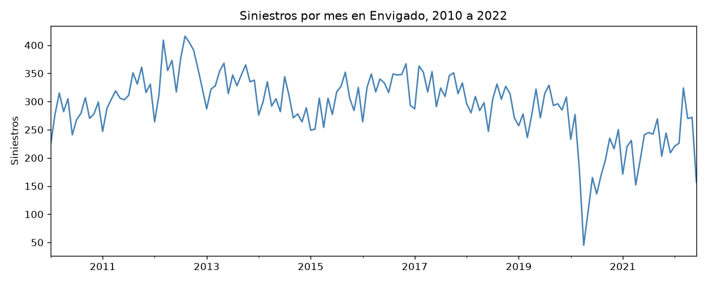
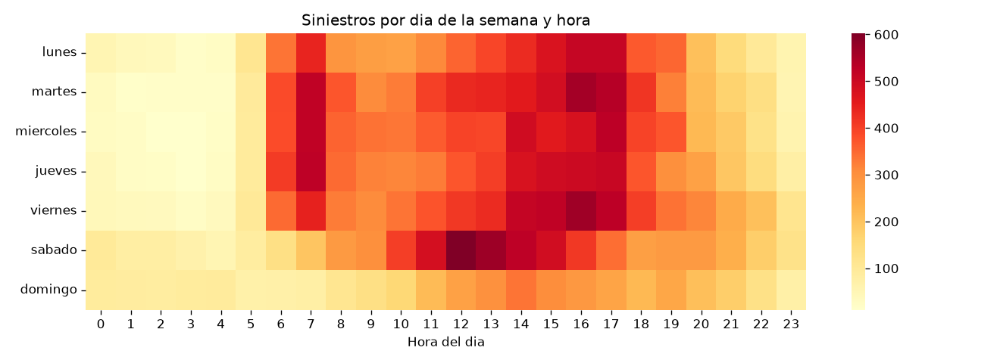
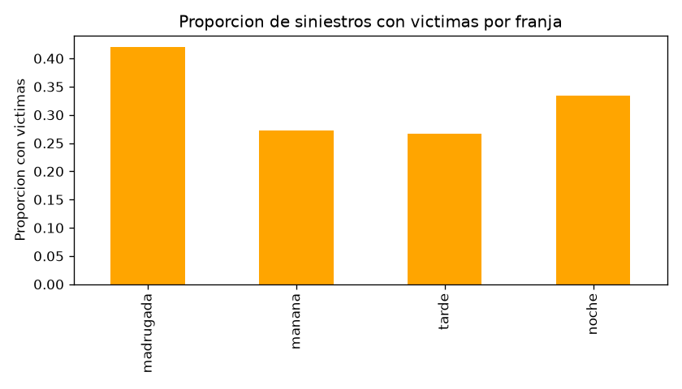
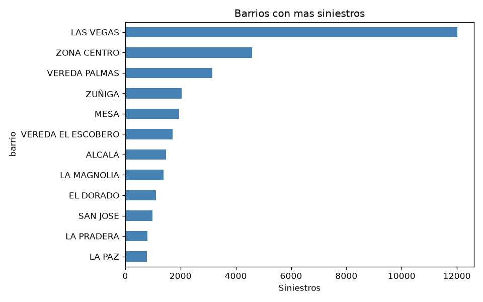
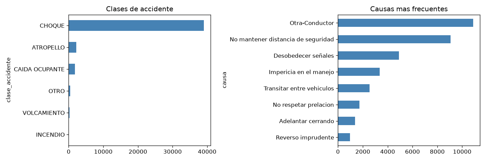
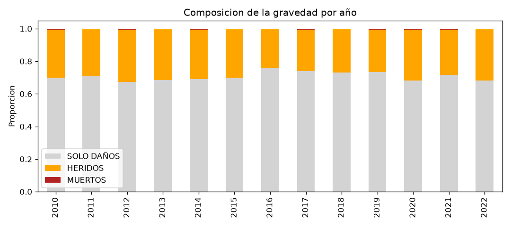

# Analisis exploratorio de la accidentalidad en Envigado

Este informe resume lo que encontramos en los datos abiertos de accidentalidad
del municipio de Envigado entre 2010 y 2022. Los numeros y las figuras salen
de la capa gold y se reproducen con `python -m src.eda`.

## Calidad de los datos

La tabla cruda tiene 89,826 filas y 17 columnas, pero llega con problemas que
resolvimos en la capa silver:

- 38,022 filas son duplicados exactos y se quitaron.
- La fecha y la hora vienen como texto en dos formatos mezclados: uno ISO y
  otro con dia/mes/año y a. m. o p. m. Se unificaron en un solo tipo de fecha.
- Las columnas de vehiculo y victima estan vacias en mas del 99% de las filas,
  asi que no se usan en el analisis.
- Solo el 26% de los siniestros tiene coordenadas, por eso el analisis espacial
  se apoya en el barrio.
- Un mismo radicado aparece en varias filas con gravedades distintas. En gold
  dejamos una fila por siniestro con la gravedad mas alta reportada.

Al final quedan 51,804 registros limpios y 43,759 siniestros unicos.

## Cuantos siniestros hay y como se reparten

- Entre enero de 2010 y junio de 2022 se registraron 43,759 siniestros.
- El 70.9% termino solo en daños, el 28.6% dejo heridos y 217 siniestros
  dejaron muertos.
- El volumen anual fue estable entre 2010 y 2019, con 3,300 a 4,300 siniestros
  por año. En 2020 cae a 2,205 por la pandemia y no vuelve al nivel anterior.

## Cuando ocurren

- Los siniestros se concentran en las horas de la tarde: entre la 1 y las
  6 de la tarde ocurre el pico del dia, con el maximo a las 4.
- De lunes a viernes el patron sigue la movilidad laboral, con un pico extra
  a las 7 de la manana. El sabado el volumen se concentra al mediodia. El
  domingo baja el volumen pero sube la gravedad: tiene la mayor proporcion de
  siniestros con victimas, 34.8%.
- La madrugada es la franja mas peligrosa: aunque tiene pocos siniestros, el
  42% deja victimas, frente al 27% de la manana y la tarde.

## Donde ocurren

- Las Vegas concentra 12,015 siniestros, el 27% del total. Es el corredor vial
  principal del municipio.
- Le siguen la Zona Centro con 4,584 y la vereda Palmas con 3,147. La vereda
  Palmas destaca porque es zona rural con via de alta velocidad.

## Como ocurren

- El choque domina con mas del 85% de los casos, pero su proporcion con
  victimas es baja, 22%.
- El atropello y la caida de ocupante casi siempre dejan victimas, 94% y 100%.
  Son pocos casos pero los mas graves para las personas.
- Las causas mas frecuentes apuntan al comportamiento del conductor: no
  mantener distancia de seguridad, desobedecer señales e impericia.

## Conclusiones

1. El problema de calidad mas grande no era el volumen sino el formato: fechas
   en dos formatos, duplicados exactos y columnas vacias. La arquitectura por
   capas deja ese trabajo hecho una sola vez.
2. La prioridad espacial es clara: Las Vegas, la Zona Centro y la vereda
   Palmas concentran mas de un tercio de los siniestros.
3. La gravedad no se reparte igual que el volumen: la madrugada y el domingo
   tienen menos siniestros pero mas proporcion de victimas, y el atropello es
   la clase mas lesiva. Las campañas de prevencion rinden mas si se enfocan
   ahi y no solo en las horas pico.
4. Estos patrones son estables entre años, lo que da base para un modelo que
   priorice siniestros con riesgo de victimas, entrenado con el pasado y
   evaluado con los años mas recientes.
