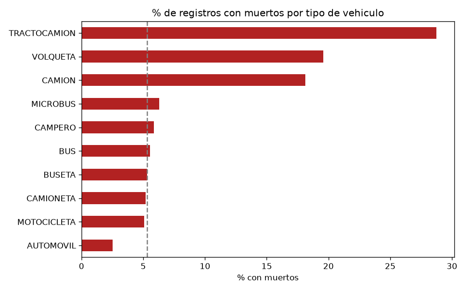
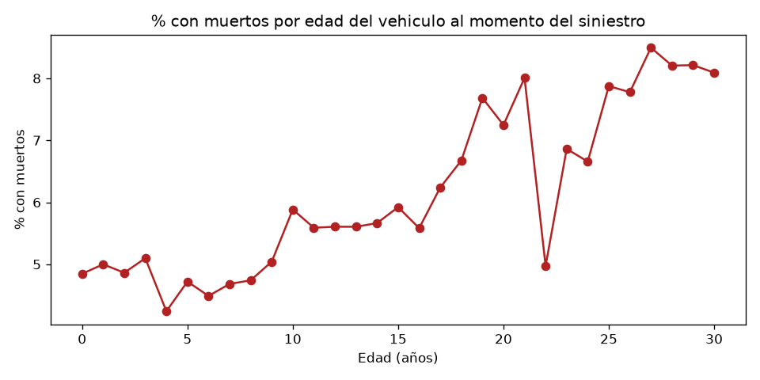
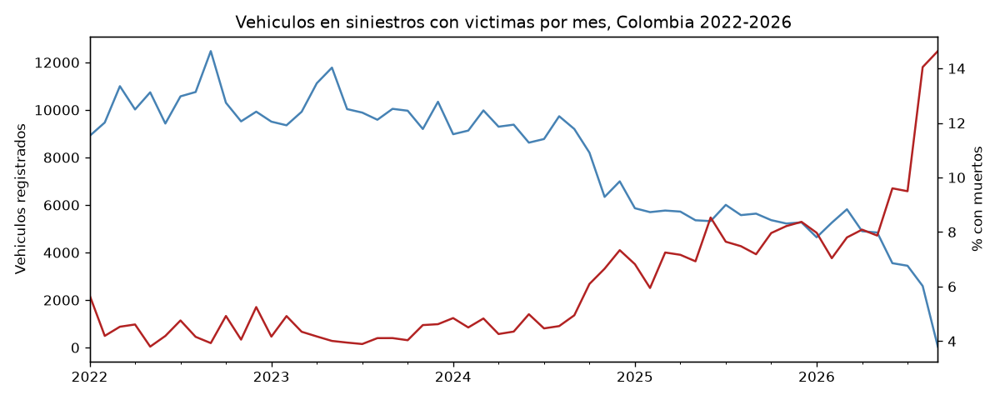
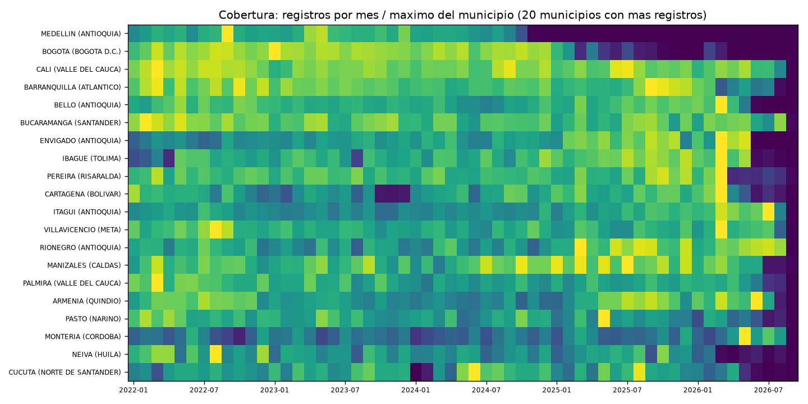

# Analisis exploratorio de los vehiculos en siniestros con victimas (RUNT)

Este informe resume lo que encontramos en el registro del RUNT de vehiculos
involucrados en siniestros de transito con heridos o muertos (Ley 2251 de
2022), publicado por el Ministerio de Transporte en datos.gov.co (conjunto
6jmc-vaxk). Cubre todo el pais entre enero de 2022 y septiembre de 2026. Los
numeros salen de la capa silver y de `gold/municipio_mes`, y se reproducen
con `python -m src.eda` despues de `python -m src.pipeline`.

## Perfil de las 9 variables

El CSV tiene 450,335 filas y 9 columnas. Cada fila es un vehiculo, no un
siniestro. El pipeline le pone a cada fila un `id_registro` (RUNT-000001 a
RUNT-450335, por su posicion en el CSV), que identifica el registro del
vehiculo, no el siniestro: la fuente no trae dia, hora ni direccion, asi que
no se puede saber que vehiculos estuvieron en el mismo siniestro.

| Variable | Valores distintos | Vacios | Observaciones |
|---|---|---|---|
| MARCA_VEHICULO | 381 | 0 | 64 marcas tienen 200 o mas filas; el resto (6,383 filas) se agrupa como OTRAS |
| MODELO_VEHICULO | 88 | 0 | Año modelo de 1937 a 2027; 83 son imposibles (despues del año del siniestro mas uno, o antes de 1950) |
| TIPO_VEHICULO | 31 | 0 | Motocicletas 56.7%, automoviles 22.2%, camionetas 8.5%, buses 3.9%, camiones 2.7% |
| EDAD_VEHICULO | 90 | 20 | Dos valores mal escritos ("2,020" y "1,826") y algunos mayores a 100 años |
| FECHA_ACCIDENTE | 57 | 0 | Mes y año (MM/AAAA), de 01/2022 a 09/2026 |
| GRAVEDAD_ACCIDENTE | 2 | 0 | CON HERIDOS o CON MUERTOS, la variable objetivo |
| DEPARTAMENTO_ACCIDENTE | 31 | 0 | |
| MUNICIPIO_ACCIDENTE | 663 | 0 | 662 nombres al quitar tildes, 689 municipios al combinarlos con el departamento |
| AUTORIDAD_DE_TRANSITO | 237 | 0 | La Direccion de Transito y Transporte (policia nacional) aparece en 645 municipios |

Decisiones de limpieza (capa silver):

- **Filas identicas.** 159,399 filas son identicas a otra en las 9 columnas
  de la fuente. No se quitan: como la fuente no trae dia ni direccion, dos
  motos de la misma marca y modelo en el mismo municipio y mes producen la
  misma fila, y quitarlas borraria vehiculos reales. Con `id_registro` cada
  una se distingue de las demas.
- **Textos.** Se quitan espacios, tildes y se pasan a mayusculas, para que
  "SECRETARÍA" y "SECRETARIA" sean la misma autoridad.
- **Clave de municipio.** `MUNICIPIO (DEPARTAMENTO)`, porque hay nombres
  repetidos en varios departamentos.
- **Edad del vehiculo.** EDAD_VEHICULO no es la edad al momento del
  siniestro: para todas las filas vale cerca de 2027 menos el modelo, es decir
  la edad a la fecha de publicacion. La diferencia con la edad al siniestro es
  de 5 años en 2022, 4 en 2023, 3 en 2024, 2 en 2025 y 1 en 2026. Por eso se
  recalcula `edad = año del siniestro - modelo` (minimo 0) y la columna de la
  fuente queda solo como referencia (`edad_fuente`). La edad al siniestro
  tiene mediana de 6 años; la de la fuente, 9.
- **Valores imposibles.** Se marcan, no se borran: `modelo_invalido` (83
  filas, quedan sin edad) y `edad_fuente_invalida` (85 filas).
- **Cargas masivas.** Los reportes atrasados que se subieron con una sola
  fecha se reparten entre los meses anteriores del municipio antes de
  calcular la edad y las alertas (21,230 filas con `fecha_imputada = 1`).
  El detalle esta en la auditoria de cobertura.

## Desbalance

- 23,899 de los 450,335 registros son de siniestros con muertos, el 5.3%. Un
  modelo que siempre diga "con heridos" acierta el 94.7% de las veces, por eso
  el modelo se evalua con PR-AUC, sensibilidad y calibracion.
- 202 municipios no tienen ningun registro con muertos y 261 tienen 10 o mas.
- La gravedad es del siniestro, no del vehiculo: si un camion y una moto
  chocan y muere el motociclista, los dos quedan "con muertos".

| Grupo | Registros | % con muertos |
|---|---|---|
| Tractocamion | 5,797 | 28.8% |
| Volqueta | 2,221 | 19.6% |
| Camion | 12,274 | 18.1% |
| Microbus | 4,813 | 6.3% |
| Motocicleta | 255,266 | 5.1% |
| Automovil | 99,900 | 2.5% |
| Autoridad nacional (policia de carreteras) | 50,068 | 22.3% |
| Autoridades municipales y departamentales | 400,267 | 3.2% |

Los vehiculos de carga tienen cuatro a siete veces la proporcion de
siniestros con muertos de un automovil. La autoridad que registra el
siniestro pesa aun mas: los registros de la policia de carreteras son
siniestros en vias nacionales, mas graves, mientras que las secretarias de
las ciudades reportan muchos siniestros urbanos con heridos.

## Auditoria de cobertura

La cobertura del registro cambia mucho entre municipios y años:

| Municipio | 2022 | 2023 | 2024 | 2025 | 2026 (a sept.) |
|---|---|---|---|---|---|
| Medellin, como se publico | 31,823 | 34,894 | 44,169 | 201 | 148 |
| Medellin, con la carga repartida | 39,439 | 43,626 | 27,821 | 201 | 148 |
| Bogota | 19,021 | 19,723 | 19,184 | 4,526 | 536 |
| Cali | 8,120 | 7,228 | 7,420 | 7,372 | 4,391 |
| Barranquilla | 3,368 | 3,073 | 2,836 | 3,088 | 1,224 |
| Bello | 2,591 | 2,311 | 2,093 | 2,590 | 1,108 |

Medellin deja de reportar casi por completo desde noviembre de 2024, y en
julio de 2024 publica 22,667 registros, 8.8 veces su mediana mensual
(2,589): una carga masiva de reportes atrasados subidos con una sola fecha.
Bogota cae desde 2025. Con las cargas ya repartidas, la proporcion nacional
con muertos sube de 5.1% en 2024 a 7.4% en 2025 y 8.6% en 2026, mientras que
sin Medellin pasa de 6.7% a 7.4% y 8.6%: buena parte del salto es un cambio
en quien reporta, no en el riesgo. Ademas, Medellin tiene solo 0.6% de
registros con muertos frente al 5.3% nacional, otra señal de que cada
autoridad reporta distinto.

**Regla de calidad.** Para cada municipio y mes se compara el numero de
registros con la mediana mensual del municipio en 2022-2024 (los meses sin
registros cuentan como cero). Un mes con mas de 3 veces esa mediana es una
carga masiva (`alerta_carga_masiva`) y uno con menos del 20% es una caida
(`alerta_caida`). Solo se juzgan los 129 municipios con mediana de al menos 5
registros al mes; en los pequeños las variaciones son azar.

**Reparto de las cargas masivas.** Antes de calcular la edad y las alertas,
silver reparte cada carga masiva: el mes se queda con su mediana de
registros (elegidos al azar con semilla 42) y el exceso pasa a los meses
anteriores del mismo municipio desde enero de 2022, en proporcion a lo que
reporto cada mes, para conservar la estacionalidad. Un vehiculo nunca va a
un año anterior al de su modelo menos uno. Las filas movidas guardan el mes
publicado en `periodo_original` y llevan `fecha_imputada = 1`. Se repartieron
64 cargas de 31 municipios: de los 24,260 registros publicados en esos
meses, 21,230 cambiaron de mes y 3,030 se quedaron. Casi todo lo movido
viene de Medellin: se quedan 2,589 registros en julio de 2024 y los 20,078
restantes se reparten entre enero de 2022 y junio de 2024 (7,616 van a 2022,
8,732 a 2023 y 3,730 a 2024). Despues del reparto se recalculan las
medianas y las alertas. `gold/municipio_mes` guarda en cada mes los
registros publicados (`registros_publicados`), los que salieron
(`registros_reubicados_desde`) y los que llegaron
(`registros_reubicados_hacia`), y el mes de origen de una carga sigue
marcado como carga masiva.

| Año | Meses con caida | Meses con carga masiva |
|---|---|---|
| 2022 | 52 | 18 |
| 2023 | 66 | 8 |
| 2024 | 72 | 16 |
| 2025 | 139 | 19 |
| 2026 | 305 | 18 |

Los 79 meses con carga masiva son los 64 de donde salio una carga y 15 que
quedan por encima de 3 veces la mediana despues del reparto (14 de ellos
recibieron filas, como Dagua en marzo de 2022 o varios meses de Rivera).
Hay 713 municipio-meses con alerta, frente a 689 antes del reparto.

En total 23,752 registros (5.3%) quedan fuera del entrenamiento
(`cobertura_anomala = 1`): los 21,230 con fecha reubicada y 2,522 mas que
caen en un municipio y mes con alerta despues del reparto. Antes del reparto
eran 26,515 (5.9%). Los registros que se quedan en el mes de una carga, como
los 2,589 de Medellin en julio de 2024, si entran, porque ese mes queda con
un conteo normal. Las alertas se multiplican en 2025 y 2026, que ademas
llegan incompletos. Por eso el modelo se valida con 2022-2024 y evalua
2025-2026 aparte. Los municipios con mas meses de caida son El Carmen de
Viboral (26), Medellin (23), Frontino (22), La Estrella (18), Bogota (16) y
Sahagun (16).

## Que implica para el modelo

- Hay 210 municipios con 100 o mas registros y reunen el 98.5% de los datos;
  son los que entran al agrupamiento.
- La autoridad y el departamento capturan diferencias de reporte ademas de
  diferencias de riesgo. El modelo puede aprender la forma de reportar; la
  validacion por municipio y por periodo lo vigila.
- Las tablas de salida estan en `data/gold`: `vehiculos` (una fila por
  vehiculo, identificada por `id_registro`, con las variables del modelo,
  `con_muertos`, `fecha_imputada` y `periodo_original`), `municipio_mes`
  (conteos publicados y despues del reparto, registros reubicados,
  proporcion con muertos y alertas de cobertura) y `municipio` (variables
  para el agrupamiento).

Las figuras `02` a `06` de `reports/figuras` son del analisis anterior de
Envigado y ya no se usan.
